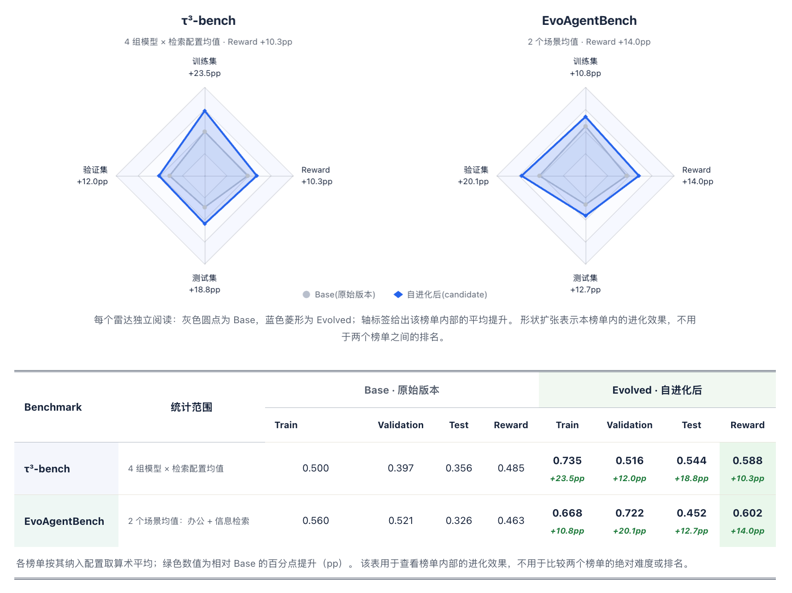

<h1 align="center">
  <br>
  KinArc<br>
  HUMAN-CENTRIC<br>
  LONG HORIZON AGENT
</h1>

<p align="center">
  <strong>以人为中心的长程智能体</strong> · <a href="https://yixin-ailab.github.io/KinArc/">项目主页</a>
</p>

<p align="center">
  从完成任务，到成就人的决策：基于关系的上下文管理、理解意图与信任的变化、<br>
  持续推进决策进程，让每一次交互最终转化为真实的业务结果。
</p>

<p align="center">
  <em>为人的长期决策旅程而生。</em>
</p>

---

## 从任务交付到长期目标推进

一次方案交付之后，客户可能仍在犹豫，审批可能还在等待。可靠地完成当前任务，
还需要连接到后续的沟通、决策与行动。KinArc 围绕四个方面组织长程 Agent：

- **目标跨时间延续**：围绕长期目标组织阶段任务，保留上下文与执行进度，在资料补充、审批反馈或条件变化后接续推进。
- **决策融入领域知识**：结合业务知识、规则与工具理解行动条件，根据用户需求、任务状态和执行反馈选择下一步。
- **理解持续变化的人**：通过跨会话记忆与上下文扩展，记录偏好和承诺，组织意愿、预算、信任与顾虑等信息，让方案与沟通贴合用户当下的处境。
- **以反馈改善后续表现**：围绕交付质量、需求满足程度与长期目标进展定义评测，将失败归因、候选优化与回归评测用于改进策略和技能。

这些能力可用于客服中的咨询、工单与回访，也可用于销售中的需求沟通、资料收集、
方案跟进与预约处理。客户理解方式、业务目标与评测标准由应用定义。

## 从模型到业务，以反馈持续改进

以垂域模型为基础，连接长程任务、语音交互与业务执行，将执行反馈送入评测与自进化，
再把验证后的提示词、技能和代码改进用于后续执行：

```text
┌────────────────────────────┐    ┌────────────────────────────┐    ┌────────────────────────────┐
│　　　　垂域模型 · YiXin　　   │    │  　　　长程 Agent 系统　　　  │    │         VoiceAgent         │
│　推理 / 多轮交互 / 工具调用　　│───►│　记忆 / 任务接续 / 人机协同　　│───►│  快慢思考协作 / 实时意图响应　 │
│  　　　　(已独立开源)　　　　  │    │  　　　　　(本仓库)　　　　　  │    │ 　　　　　(后续规划)　　　　   │
└────────────────────────────┘    └────────────────────────────┘    └────────────────────────────┘
               ▲                                 ▲                                 │
               ┆ 训练模型          　　　　　　　　　│ 改进 Agent         　　　　　　　　│
               ┆                                 │                                 ▼
┌────────────────────────────┐    ┌────────────────────────────┐    ┌────────────────────────────┐
│   　　领域训练与模型优化　　   │    │  　　　　评测与自进化　　　    │    │  　　　　业务执行反馈　　　    │
│  　　评测反馈 → 训练数据　　　 │◄┄┄┄│失败归因 / 候选优化 / 验证选优　│◄───│执行轨迹 / 任务结果 / 用户反馈　│
│ 　　　　　(后续规划)　　　　   │    │  　　　　　(本仓库)　　　　　  │    │                            │
└────────────────────────────┘    └────────────────────────────┘    └────────────────────────────┘
```

YiXin 提供领域推理、多轮交互与工具调用能力；VoiceAgent 纳入后续规划，计划通过快慢思考协作、
动态轮次等待与预测性生成，让语音交互跟上用户意图。

业务执行产生反馈，评测与自进化据此改进提示词、技能和代码，再用于后续执行，形成
“执行 → 反馈 → 改进 → 再执行”的闭环。图中实线表示能力与反馈关系。

后续规划：训练回流，将评测反馈转化为训练数据，进一步优化垂域模型。
该路径在图中以虚线表示，尚未纳入当前实现。

## 快速开始

准备 Python **3.13 或 3.14**、uv、Docker；运行 Web Demo 工作台还需要 Node.js **22**。
以下命令在仓库根目录执行。

### 1. 准备环境

```bash
git clone https://github.com/YiXin-AILab/KinArc.git
cd KinArc
uv sync
cp .env.example .env
cp deploy/runtime/.env.example deploy/runtime/.env
```

### 2. 启动 Redis 与后端

```bash
deploy/runtime/start.sh --profile redis
uv run agentsystem
```

### 3. 启动 Web Demo 工作台

在另一个终端执行：

```bash
cd web
npm ci
npm run dev
```

浏览器访问 `http://127.0.0.1:10061`，选择 Agent 并开始对话。
开发服务器会将 `/v1` 请求代理到本地后端。

## 构建自己的 Agent

一个 Agent 的提示词、插件和技能放在同一个应用目录中：

```text
application/my_agent/
├── config/agent.yaml    # 模型、能力选择与运行参数
├── prompt/              # 提示词
├── plugins/             # 工具、中间件与上下文提供器
├── skills/              # 应用级技能
├── knowledge/           # 应用级知识库
└── ...                  # 其他业务代码、数据与资源
```

业务扩展通过插件入口 `register(context)` 注册。工具负责执行动作，中间件介入运行、
模型和工具调用过程，上下文提供器补充当前任务所需的信息；公开输出可通过
`PublicProjector` 扩展。

## 自进化

最新实验覆盖 τ³-bench 的 banking 场景，以及 EvoAgentBench 的办公与信息检索场景。
6 组实验均从原始 Agent 出发，自进化后的 Candidate 在表中报告的 40 项前后对比中全部提升。
两个基准的任务和评分口径不同，下方分开展示，不对绝对分数做横向混算。
各项自进化任务的过程与结果数据，请查看[自进化实验数据](https://huggingface.co/datasets/YiXin-AILab/KinArc-Evolution)。



了解自进化机制与使用方法，请查看[自进化文档](evolution/README.md)。

## 项目结构

| 目录 | 内容 |
| --- | --- |
| `agentsystem/` | Runtime 核心、模型适配、工具、技能、记忆、知识库及存储实现 |
| `server/` | HTTP/SSE 接口、服务生命周期与平台 API |
| `web/` | Vue 3 对话与配置工作台 |
| `application/` | Agent 应用及其配置、提示词与扩展资产 |
| `skills/`、`knowledge/` | 全局共享技能与知识库 |
| `evaluation/`、`eval_tasks/` | 通用评测系统与评测任务 |
| `evolution/`、`evolution_tasks/` | 自进化系统与优化任务 |
| `deploy/` | 本地中间件与部署脚本 |
| `tests/` | 单元、合约、集成及端到端测试 |

## 开发

```bash
uv sync
uv run ruff format --check agentsystem server tests application evolution evolution_tasks
uv run ruff check agentsystem server tests application evolution evolution_tasks
uv run mypy
uv run pytest
uv run pre-commit run --all-files
```

## Citation

如果本项目对你的研究或工作有所帮助，欢迎引用：

```bibtex
@misc{kinarc2026,
  title = {{KinArc}: Human-Centric Long Horizon Agent},
  author = {{YiXin-AILab}},
  year = {2026},
  publisher = {GitHub},
  howpublished = {\url{https://github.com/YiXin-AILab/KinArc}}
}
```

## 许可证

本项目自行编写且有权授权的代码采用 [MIT 许可证](LICENSE)。第三方代码与资源遵循各自
许可证，来源与许可声明见 [第三方声明](THIRD_PARTY_NOTICES.md)。
